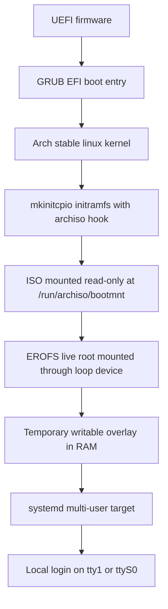

# Phase 1 boot architecture

The first Seyrix image uses Arch Linux's `archiso` live boot path. The tracked
profile in `config/archiso/` is based on the `baseline` profile shipped in
`archiso` 91-1 and retains the upstream boot infrastructure.

## Firmware and bootloader

The image supports UEFI through the upstream GRUB boot mode and retains the
baseline Syslinux BIOS boot mode. The QEMU acceptance workflow uses OVMF UEFI;
the BIOS path is built but was not exercised. The UEFI test runs with Secure
Boot disabled. No custom bootloader or kernel is introduced.

GRUB displays Seyrix branding and sends boot output to the serial console when
one is available. The kernel command line includes both the virtual console
and a 115200-baud serial console. A serial getty provides an interactive login
for unattended QEMU verification. The normal local virtual terminal remains
available as well.

## Live root and init

Arch's stable `linux` package and `mkinitcpio-archiso` create the kernel and
initramfs. During boot, the archiso initramfs mounts the ISO at
`/run/archiso/bootmnt`, mounts the EROFS root image through a loop device, and
provides a writable overlay backed by RAM. QEMU evidence shows the boot medium
mounted as `/dev/sr0`, the live root image mounted as `/dev/loop0`, and the
final root filesystem reported as `overlay`.

The overlay is temporary. No persistent disk, ext4 root, or installation
workflow is part of Phase 1. The ISO includes systemd, pacman, Arch's base
userspace, command-line hardware tools, firmware, and wired and wireless
networking components. `systemd-networkd` and `systemd-resolved` start for
network access; `iwd` is available for manual wireless setup but is not enabled
by default.

## Login, services, and security boundary

Systemd reaches the multi-user target and starts getty on `tty1` and `ttyS0`.
The image preserves the Archiso baseline's empty root password for local
console access. It does not automatically log in, install OpenSSH, or start a
remote login service. The root login policy is for disposable development
images and must be reviewed before any production image.

Cloud-init and unrelated Hyper-V, VirtualBox, VMware, and QEMU guest agents
were removed from the profile. Only the networking services needed by this
image are enabled. The image retains Arch package license files and uses
pacman's required package-signature policy.

## Verification boundary

QEMU verifies the UEFI firmware path, kernel and initramfs startup, the live
root and overlay, systemd, serial login, shell commands, DHCP on the emulated
Ethernet device, hardware enumeration, and clean shutdown. The test does not
claim physical-device compatibility, graphics acceleration in a desktop, Wi-Fi
operation, Secure Boot, persistent installation, or production readiness.
