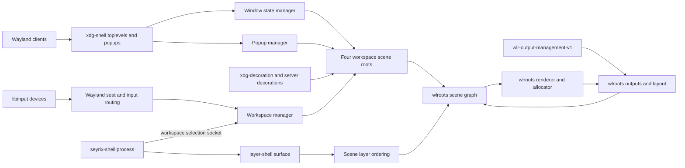

# Seyrix compositor architecture

The Phase 2C compositor is a native C17 Wayland compositor built against the
wlroots 0.20 API series. wlroots owns backend, DRM/KMS, libinput, rendering,
seat, and protocol primitives. Seyrix owns window state, workspace membership,
focus policy, decorations, shell process lifecycle, and output policy.

## Ownership and lifecycle

`main.c` owns the Wayland display, backend, renderer, allocator, output layout,
scene, seat, cursor, signal sources, and child processes. It creates scene
layers in background, bottom, window, top, and overlay order. The four
workspace scene roots live inside the window layer. Shutdown destroys Wayland
clients before window, popup, decoration, layer-shell, output, input, shell,
workspace, scene, renderer, and backend state; child processes are reaped with
bounded graceful and forced shutdown, preserving the Phase 2B.1 ordering fix.

`workspace.c` owns the four initial workspace records, window membership,
per-workspace stacking order, focus history, switching, and migration. Each
workspace has a disabled or enabled scene root. Switching changes scene-root
visibility and focus; it does not unmap, destroy, or recreate client surfaces.
The active-workspace index is compositor-wide in this phase. Membership and
focus state are kept in a workspace manager so the model can later be extended
to per-output workspace sets without coupling it to rendering.

`window.c` owns xdg-shell toplevel lifetime, map/unmap, focus activation,
stacking, move/resize grabs, and destruction. It attaches new transient
toplevels to their parent's workspace and other toplevels to the active
workspace. Focus changes reject hidden or minimized windows before changing
seat focus. Pointer hit testing walks the enabled scene, so disabled workspace
trees cannot receive pointer focus. Workspace switches clear pointer focus and
restore the destination workspace's remembered eligible window.

Absolute device coordinates are passed to `wlr_cursor_warp_absolute`, which
maps normalized device coordinates into the output layout. Pointer hit testing,
interactive grabs, and scene-node positions then use layout coordinates. A
resize keeps the unselected client edge anchored when min/max constraints clamp
the requested size; the compositor sends the constrained size through xdg-shell
and records the resulting committed geometry.

`window-state.c` owns maximize, unmaximize, fullscreen, restore geometry, and
minimize state. It tracks the requested state separately from wlroots'
committed xdg-toplevel state. The compositor sends size and state configure
events through wlroots; it uses the committed state when saving normal
geometry. Fullscreen takes precedence over maximize. Maximize uses the
layer-shell work area, fullscreen uses the selected output box, and leaving
either state restores the saved normal geometry after constraining it to a
live output. Minimize is a compositor-owned hidden state: the surface remains
mapped and the application keeps running. **Super+M** hides the focused
window; **Super+Shift+M** restores a minimized window on the active workspace.

`popup.c` creates real scene trees for xdg popups under their parent toplevel
or layer surface. Nested popups follow the parent tree. Initial configure,
reposition, unconstrain, dismissal, active grabs, and destruction are tracked
without substituting toplevels for popups. Workspace switches and minimizing a
parent dismiss its popup descendants before hiding them.

`decoration.c` negotiates `xdg-decoration` mode per toplevel. Server title bars
are rendered only when server-side decoration was selected. Clients that
request or negotiate client-side decoration retain their own chrome. Hit
testing and title-bar geometry use the same decoration state as rendering.

`layer-shell.c` owns layer-shell surfaces and arranges them around each output's
usable area. The native `seyrix-shell` client is a separate C process. It maps
a small top-layer panel, handles pointer clicks for workspace selection, and
communicates selection requests and active-workspace updates over a private
local socket. When an output is disabled or removed, the protocol surface and
its compositor record move together to a remaining enabled output and are
rearranged there. A panel crash closes the channel but does not stop the
compositor.

`output.c` owns one record and scene output per connected output. It enables
the preferred mode, maintains the output layout and scene, and exposes
`wlr-output-management-v1` test/apply configuration. Configurations must
include every known output and keep at least one enabled output; wlroots backend
validation runs before application. Output changes update work areas and
reconfigure maximized/fullscreen windows. If an output disappears, normal
geometry is constrained to a surviving output and fullscreen output requests
are cleared. Removing the final output terminates the compositor.

## Protocol support

- `xdg-shell` version 6: toplevels, state requests, minimize requests, popups,
  popup grabs, and configure/acknowledge flow through wlroots.
- `xdg-decoration` version 1: negotiated client-side or server-side mode.
- `wlr-layer-shell-unstable-v1`: panels and layer-surface popups.
- `wlr-output-management-unstable-v1`: tested and applied output
  configuration, including position and scale.
- `wl_seat` keyboard and pointer routing with scene hit testing and popup
  grab handling.

The compositor runs under the unprivileged `seyrix` login session using
libseat/logind. QEMU uses software rendering; renderer identity comes from
guest runtime logs rather than a hardware-acceleration assumption.

## Workspace shortcuts

- **Super+Left / Super+Right** switches to an adjacent existing workspace.
  Phase 2C does not wrap at the first or last workspace.
- **Super+Shift+Left / Super+Shift+Right** moves the focused visible toplevel
  to the adjacent workspace while preserving its running client and scene
  tree.
- **Super+1 through Super+4** selects the initial workspaces. **Super+5
  through Super+9** are consumed because those workspaces do not exist yet.
- The panel also selects an existing workspace by pointer.

Stacking order and focus history are independent per workspace. Minimized
windows remain members of their workspace. Popups are dismissed when their
parent workspace is hidden, preventing stale grabs from blocking later
switches.

## Current limits

Per-monitor workspaces, animated switching, persistent output profiles, full
HiDPI policy, Xwayland, a launcher, and a taskbar are not implemented. QEMU
verification used one virtio-vga output, so output hotplug, output removal with
mapped windows, and physical multi-monitor support remain unverified. The
1.25-scale output configuration path was exercised in QEMU, but this does not
establish broad HiDPI compatibility.

The Phase 2C report records functional evidence and incomplete checks. A
successful compile or protocol registration alone is not evidence that an
interaction works.
