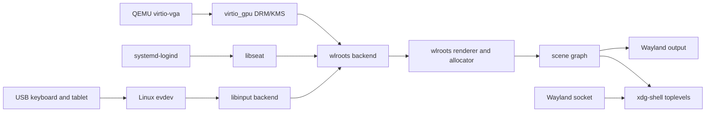

# Seyrix compositor architecture

The Phase 2B compositor is a small C17 Wayland compositor built with the
Arch `wlroots0.20` package. The implementation targets the 0.20 API series;
the verified build uses wlroots 0.20.2-1 and compiles against the headers
installed by that package. It uses wlroots for DRM/KMS, the libinput backend,
renderer and allocator setup, seat handling, xdg-shell, and the scene graph.

## Ownership and lifecycle

`main.c` owns the Wayland display, backend, renderer, allocator, output layout,
scene, seat, cursor, signal sources, and child terminal processes. It creates
these resources before starting the backend so the backend's initial output
and input discovery events can be handled immediately.

`output.c` owns one small record per output. It enables the preferred mode,
connects the output to the scene and layout, draws the Seyrix background, and
updates the background when the output size or position changes. Output
destruction removes its scene background and record. The compositor stops if
the final output disappears.

`input.c` owns keyboard and pointer event handling. Each discovered keyboard
gets an XKB keymap and is attached to the single Wayland seat. The seat sends
keyboard events to its focused surface. The cursor hit-tests scene surfaces,
forwards pointer motion, buttons, axes, and frames, and raises a window when it
receives focus. Device destruction removes the associated listeners and state.

`window.c` owns mapped xdg-shell toplevel state. Map and unmap events update the
window list and keyboard focus. Destroy events clear focus and interactive
grabs before freeing compositor state. Client move and resize requests require
a valid pointer-grab serial for the requesting surface. Unsupported maximize
and fullscreen requests receive the required xdg-shell configure response.

The scene graph owns rendered surface nodes. Each toplevel record stores its
scene tree and does not retain client-owned buffers. When clients disconnect,
Wayland and wlroots destroy their surfaces; compositor listeners then remove
window records. Shutdown destroys clients before the backend, scene, renderer,
and display. Child terminal processes receive a bounded graceful shutdown and
are reaped.

## Supported behavior

- Wayland display and wlroots DRM/KMS backend through the logind session.
- wlroots renderer selected by wlroots; the launcher sets
  `LIBGL_ALWAYS_SOFTWARE=1` and `WLR_RENDERER_ALLOW_SOFTWARE=1` for the QEMU
  software-rendering path. The Phase 2B report records the renderer from guest
  logs and does not claim hardware acceleration.
- Solid dark Seyrix background and visible Xcursor pointer.
- Output enablement, mode selection, resize handling, and hot removal.
- xdg-shell version 3 toplevel windows, focus, stacking, movement, resizing,
  close requests, and safe destruction.
- Keyboard and pointer input through the libinput backend and a Wayland seat.
- `weston-terminal` launches at startup and with **Super+Return**.
- **Super+Q** sends an xdg-shell close request to the focused window.
- **Super+Shift+Q** exits the compositor cleanly.
- **Alt+left-drag** moves a window. **Alt+right-drag** resizes from its lower
  right edge.

Shortcuts use the Super modifier so they do not consume ordinary application
input. Shortcut key releases are also consumed after their corresponding
presses to avoid leaving a key in a client-side pressed state.

## Current limits

The compositor supports xdg-shell toplevel surfaces, not popup surfaces. It
has no title bars, decorations, panels, taskbar, desktop shell, maximize or
fullscreen behavior, Xwayland, HiDPI configuration, or persistent output
configuration. Maximize and fullscreen requests are acknowledged without
changing the window state. These limits keep Phase 2B focused on rendering,
input, window lifecycle, and clean shutdown. Aero and Chroma remain future work.

The renderer choice and driver name come from wlroots and Mesa runtime logs.
`WLR_RENDERER` in the compositor log records a requested override, if one was
set; it does not claim hardware acceleration. The Phase 2B report records the
renderer observed in the verified QEMU guest.
