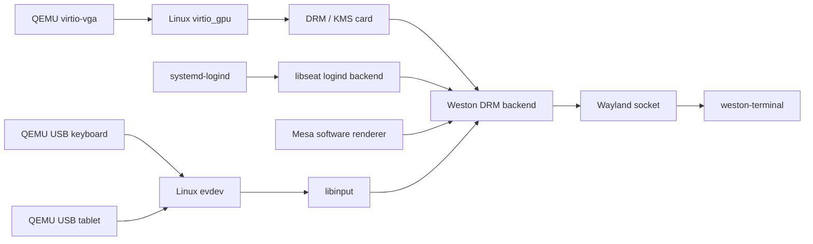

# Phase 2A graphics architecture

**State:** Phase 2A acceptance passed in graphical QEMU on 2026-10-25. See the
[engineering report](phase2a-report.md) and [test record](wayland-testing.md).

## Stack

Arch Linux's `linux` package supplies the existing `virtio_gpu` kernel driver.
The image does not change the kernel or add a custom driver. Weston uses DRM/KMS
for output, logind through libseat for session and device access, and libinput
for udev-discovered keyboard and pointer devices. Wayland clients connect to a
socket under the unprivileged session's `/run/user/1000` directory.

QEMU exposes a UEFI framebuffer as `simpledrm` before the Virtio GPU takes over.
That can leave the Virtio KMS device at `/dev/dri/card1` instead of `card0`.
`start-wayland` scans DRM cards, skips the simple framebuffer, and gives
Weston's DRM backend the selected `cardN` explicitly. This prevents Weston from
choosing the boot framebuffer while the Virtio device is available.

The compositor is **Weston**, the existing reference compositor. The initial
session opens `weston-terminal`; it does not install a full desktop environment
or a Seyrix compositor. Type `exit` in Weston Terminal to stop the application,
let the launcher stop Weston, and return to the tty1 development shell.

## Development session and recovery

`systemd-sysusers` creates account `seyrix` with UID/GID 1000 and no valid
password credential. `systemd-tmpfiles` creates its home with mode `0700`. A
getty drop-in enables automatic login for this account on local `tty1` only.
This is a development-only convenience for the disposable live image.

`/usr/local/bin/start-wayland` rejects root and any terminal other than
`/dev/tty1`; it also requires active `systemd-logind`. Weston runs as `seyrix`
with `LIBSEAT_BACKEND=logind`. The existing serial getty remains enabled for
root diagnostics and recovery. Boot still reaches the existing console path;
graphical startup is a manual command, not a boot dependency.

The launcher sets `LIBGL_ALWAYS_SOFTWARE=1`, starts Weston with the Mesa GL
renderer, then retries with Pixman if GL initialization fails. This is an
explicit software-rendering policy for the initial QEMU test. The QEMU profile
uses TCG, `gl=off`, and a Virtio GPU with VirGL disabled; no hardware 3D
acceleration is claimed.

## Added packages and license data

The profile explicitly adds `mesa`, `libinput`, `evtest`, `weston`,
`ttf-dejavu`, and `xkeyboard-config`. `wayland`, `libdrm`, `seatd`, systemd,
fonts, protocol data, and graphics libraries are installed as direct or
transitive dependencies. `seatd` supplies libseat; the test uses its logind
backend and does not enable the seatd service.

Versions and license expressions below are those installed in the Phase 2A
image. Exact direct dependencies and the complete dependency closure are
checked in under
[phase2a-package-metadata](phase2a-package-metadata/): `graphics-stack-info.txt`
records the graphics packages' direct dependencies and license expressions;
`image-package-info.txt`, `image-packages.txt`, and
`image-package-licenses.txt` capture the complete image package set.

| Package | Version | Direct dependencies | License expression recorded by pacman |
|---|---|---|---|
| `weston` | 15.0.1-3 | fontconfig, glibc, wayland, libxkbcommon, libinput, libunwind, pixman, libdrm, pam, systemd-libs, cairo, libpng, libjpeg-turbo, libwebp, mesa, libegl, libevdev, libgles, glib2, pango, lcms2, mtdev, libx11, libxcb, dbus, libva, libxcursor, colord, seatd, libdisplay-info, gstreamer, gst-plugins-base-libs | MIT |
| `mesa` | 1:26.2.5-1 | expat, glibc, libdrm, libelf, libgcc, libglvnd, libstdc++, libx11, libxcb, libxext, libxshmfence, libxxf86vm, llvm-libs, lm_sensors, spirv-tools, wayland, zlib, zstd | MIT AND BSD-3-Clause AND SGI-B-2.0 |
| `libinput` | 1.32.0-1 | glibc, libevdev, libgcc, libwacom, lua54, mtdev, systemd-libs | MIT |
| `evtest` | 1.36-1 | glibc | GPL |
| `wayland` | 1.26.0-1 | glibc, libffi, expat, libxml2, default-cursors | MIT |
| `libdrm` | 2.4.134-1 | libpciaccess, glibc | MIT |
| `seatd` (libseat) | 0.9.3-1 | systemd-libs | MIT |
| `systemd` / logind | 262.1-1 | See full package metadata | LGPL-2.1-or-later, CC0-1.0, GPL-2.0-or-later, MIT-0 |
| `ttf-dejavu` | 2.37+18+g9b5d1b2f-8 | none | custom |
| `xkeyboard-config` | 2.48-1 | none | LicenseRef-xkeyboard-config |

The Arch package license files are retained in the image. Redistributors must
retain the applicable package notices and license texts. The repository does
not yet declare a project-wide license; the Archiso profile keeps its upstream
GPL-3.0-or-later notice.

## Measured renderer

The verified QEMU session selected `/dev/dri/card1`, acquired the seat through
libseat's logind backend, and used Mesa's `llvmpipe (LLVM 23.1.3, 128 bits)`
renderer. QEMU ran with TCG, `gl=off`, and VirGL disabled; this is software
rendering. The loaded `virtio_gpu` kernel driver provides the virtual 2D DRM/KMS
device, but hardware 3D acceleration was not measured or claimed. The full
startup log is in
[`docs/evidence/phase2a/graphics-verified-exit/test-transcript.txt`](evidence/phase2a/graphics-verified-exit/test-transcript.txt).

## Limits

- Arch is rolling-release. The profile records exact versions per build but
  does not pin an immutable repository snapshot or prove byte-for-byte
  reproducibility.
- QEMU TCG and software rendering measure this emulated configuration only.
- Secure Boot, physical GPUs, hardware acceleration, hot-plugging, and other
  physical input devices remain outside this test scope.
- The password-disabled account and tty1 automatic login are for development
  images; do not ship this session policy as a production default.
