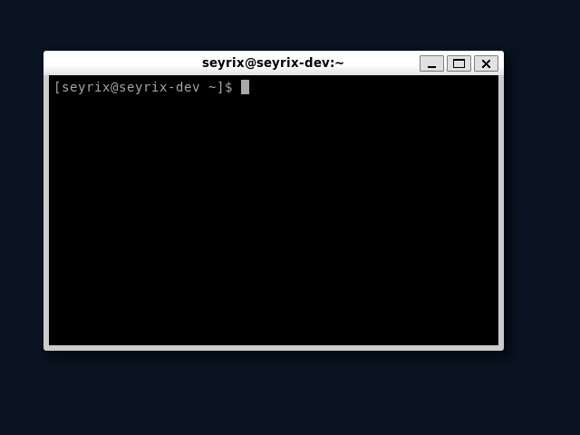
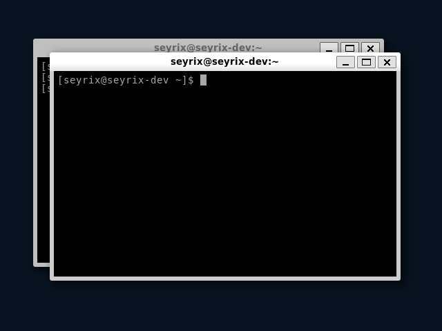
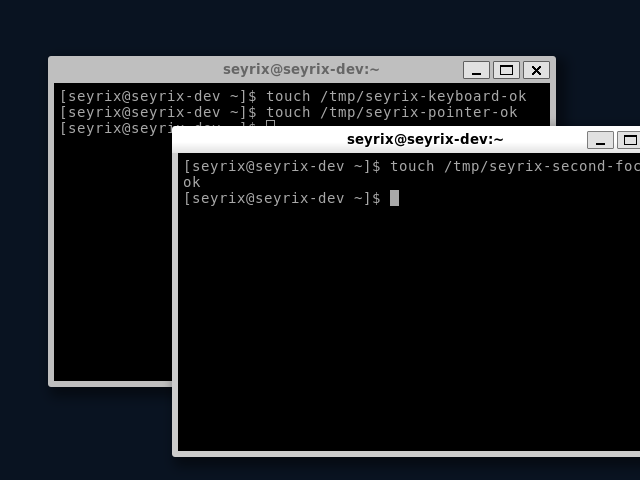
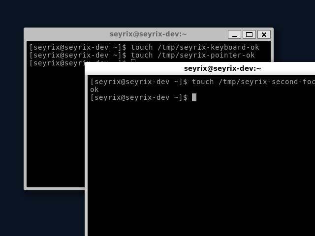
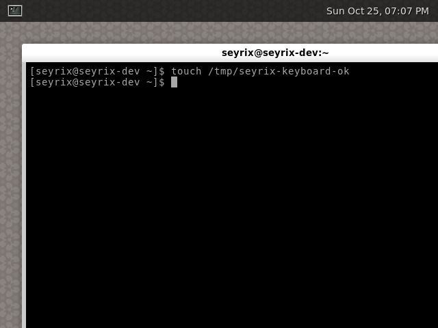

# Phase 2B engineering report

**Status: COMPLETE** on `phase2b-seyrix-compositor`.

Phase 2B adds the first native Seyrix Wayland compositor in C17. The compositor
uses Arch Linux's `wlroots0.20` API, renders through the DRM/KMS backend, takes
input through libinput and libseat, and manages xdg-shell v3 toplevel windows.
The new `start-seyrix` command is manual; `start-wayland` remains available as
the Weston reference session and the serial recovery terminal remains enabled.

## Acceptance results

| Requirement | Result | Evidence |
| --- | --- | --- |
| C17 compositor builds with Meson and Ninja | Pass | `Werror=true`; the Phase 2B ISO build completed successfully. |
| Updated ISO builds and boots with UEFI QEMU | Pass | q35, OVMF, 4 GiB RAM, virtio-vga, USB keyboard/tablet, and TCG. |
| Seyrix launches as the unprivileged console user | Pass | libseat opened the active systemd-logind session. |
| Desktop background renders | Pass | QEMU screenshots below. |
| Pointer motion and clicks work | Pass | Evdev motion and button events reached the compositor; click changed window focus. QMP screenshots omit the live cursor image, so saved screenshots do not independently verify cursor visibility. |
| Wayland application opens and accepts keyboard input | Pass | `weston-terminal` mapped; keyboard test created its guest marker. |
| Multiple windows coexist and receive focus | Pass | Two xdg-shell windows mapped; keyboard and pointer focus checks passed. |
| Windows move, resize, and close safely | Pass | Alt+left drag, Alt+right drag, and Super+Q checks passed. |
| Compositor exits cleanly | Pass | Super+Shift+Q returned to the tty1 shell and removed the compositor process. |
| Guest shuts down cleanly | Pass | Phase 2B graphical run, Weston reference run, and Phase 1 serial regression all powered off successfully. |
| Weston reference session still works | Pass | `start-wayland` launched Weston with its terminal; keyboard/mouse and tty return checks passed. |
| Phase 1 terminal regression passes | Pass | Serial login, system checks, and clean shutdown passed on the Phase 2B ISO. |

## Build and image

The image was built inside Arch Linux WSL using Arch's signed repositories.
The build resolved `wlroots0.20` 0.20.2-1 and compiled against its installed
headers. The image contains 240 packages.

- ISO: `seyrix-phase2b-2026.10.25-x86_64.iso`
- Size: 1,039,171,584 bytes (about 991 MiB)
- SHA-256: `2bdd3f1a3c6cb0f6998291400ea455f55d8b004b5a2869c930380c65ec3fd645`
- Native build tools: GCC 16.2.1, Meson 1.12.1, Ninja 1.13.2
- Runtime stack: wlroots 0.20.2, Weston 15.0.1, Wayland 1.26.0

Build metadata, package manifests, the ISO checksum, QEMU commands, serial
transcripts, and test output are preserved under
[`docs/evidence/phase2b/`](evidence/phase2b/). The ISO itself remains in the
WSL build cache and is not committed to the repository.

## Runtime baseline

The final Seyrix test ran under QEMU TCG with a 640×480 virtio-vga output.
wlroots logged `llvmpipe (LLVM 23.1.3, 128 bits)` as the GL renderer. This is
Mesa software rendering; no hardware acceleration is claimed.

- Boot to serial login: 57,217 ms
- Compositor startup marker: 12,258 ms
- Boot to the mapped Seyrix terminal: 80,672 ms
- Compositor resident memory at the ready check: 114,208 KiB
- Compositor processes: 1
- Guest memory at the ready check: 3,994,664 KiB total, 3,615,480 KiB available
- Installed packages: 240
- ISO size: 1,039,171,584 bytes

Keyboard commands reached the terminal, pointer motion and clicks were
recorded, and move/resize interactions changed window state. The desktop was
usable in the QEMU session. The default Xcursor loaded without errors. QMP
screen dumps omit the live cursor image, so retained screenshots document the
desktop and windows but do not independently confirm the rendered cursor. A
live QEMU screen capture timed out during two attempts. No frame-time
instrumentation was available, so no FPS or frame-time figure is reported.

One supplemental QEMU launch encountered a guest scheduler panic in
`enqueue_task_fair` before userspace started. The cause was not diagnosed. A
subsequent complete Phase 2B run passed the graphical acceptance checks and
shut down cleanly; the panic did not recur in that run.

## Screenshots

The screenshots are from the final Phase 2B UEFI QEMU run unless labeled
Weston. PNG checksums are listed in
[`docs/evidence/phase2b/screenshots.sha256`](evidence/phase2b/screenshots.sha256).

## Design and limitations

The compositor owns its Wayland display, wlroots backend, renderer, allocator,
output layout, scene, seat, cursor, listeners, and spawned terminal processes.
Output, input, and xdg-shell window handling live in separate source files.
Window records track map/unmap/destroy state; a destroyed window clears focus
and any active pointer grab before its record is freed. Interactive xdg-shell
move and resize requests are checked against the seat's pointer-grab serial.
The implementation and ownership model are described in
[`compositor-architecture.md`](compositor-architecture.md).

The compositor currently supports xdg-shell v3 toplevels. It does not support
xdg popups, Xwayland, title bars, decorations, panels, a taskbar, multiple
configured outputs, HiDPI scaling, or persistent output settings. Maximize and
fullscreen requests are acknowledged without changing the window state. Use
Alt+left-drag to move a window, Alt+right-drag to resize it, Super+Return to
open a terminal, Super+Q to request window close, and Super+Shift+Q to exit.

Aero and Chroma styling, a dock/taskbar, and a graphical login manager were
not part of Phase 2B. `start-seyrix` remains a manual development-session
launcher; the system does not boot directly into the new compositor.
