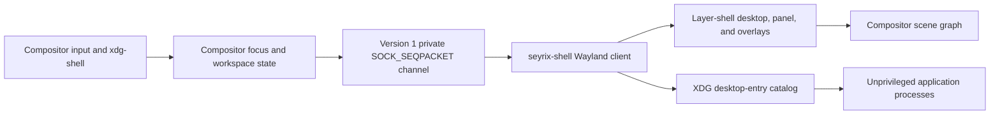

# Phase 2D.2 — Native Desktop Shell Report

**Decision: INCOMPLETE — awaiting runtime verification.** The shell client built and its supported cloud tests ran, but this environment lacks wlroots 0.20.2, a graphical device, and QEMU. The compositor was not built, Phase 2D.1 regression tests were not run, and no graphical runtime behavior is claimed. An Arch package/container build was investigated; package retrieval through the configured proxy returned HTTP 403, so the equivalent Debian container was used only for the independent shell client build.

## 1. Architecture

The compositor keeps authority over workspace changes, window focus, and overlay ownership. The desktop, panel, launcher, switcher, and Manual viewer are surfaces from one unprivileged C17 Wayland client. The shell has no direct access to compositor structures.



The compositor creates a private Unix `SOCK_SEQPACKET` socket pair for its shell child. `desktop/common/shell-ipc.h` defines protocol version 1, exact packet layouts, and bounded window metadata. Messages cover snapshots, focus, workspace selection, and overlay actions; there is no command-string or arbitrary execution message. The compositor checks the shell PID and overlay namespace before granting shell overlay keyboard focus.

## 2. Baseline and branch

- Verified base commit: `d1873c68a29b24e285e58568551b030985ef8b98`.
- Development branch: `phase2d2-desktop-shell`.
- The base checkout was clean before implementation.
- Implementation commit reviewed: `2f79a22e56c2a64416f078c1b569c7eb2f13b326` (`feat: add native Seyrix desktop shell`). This commit contains code, tests, the ISO build script, and build-guide changes. This report and raw evidence are committed separately after it.
- The seven workstation-only `config/archiso` edits and Phase 2C.2 EGL investigation working files were not present in the cloud checkout. They were not reconstructed or changed.

## 3. Changed files

The implementation commit changes:

- Build and session: `build/build-phase2d2-iso.sh`, `config/compositor-overlay/airootfs/usr/local/bin/start-seyrix`, `config/compositor-overlay/packages.x86_64`, `docs/build-guide.md`.
- IPC and compositor integration: `desktop/common/shell-ipc.h`, `desktop/compositor/meson.build`, `desktop/compositor/src/input.c`, `layer-shell.c`, `main.c`, `seyrix.h`, `shell.c`, `shell.h`, `window-state.c`, `window-state.h`, `window.c`, `workspace.c`.
- Shell client: `desktop/shell/meson.build`, `desktop/shell/src/main.c`, `app-catalog.c`, `app-catalog.h`, `shell-config.c`, `shell-config.h`, `shell-state.c`, `shell-state.h`, `shell-ui.c`, `shell-ui.h`, `desktop/shell/data/Manual.txt`.
- Tests: `tests/session-lock-test.sh`, `tests/shell-app-catalog-test.c`, `tests/shell-config-test.c`, `tests/shell-state-test.c`, `tests/shell-ui-test.c`.

Raw logs and commands for cloud-supported checks are in `docs/evidence/phase2d2/`.

## 4. Desktop surface

The shell creates one full-output background layer surface per output and resizes/redraws it when Wayland reports output geometry or scale changes. It paints a validated configured solid color, then optionally loads a local image and scales it to cover the output. Missing or invalid wallpaper logs a warning and retains the solid-color fallback.

The desktop surface input region contains only the `Manual.txt` item. The background itself does not accept pointer input or keyboard focus. Applications remain above the desktop layer. The item opens a read-only shell modal that loads `/usr/share/seyrix/Manual.txt` with `O_NOFOLLOW`, requires a regular file, and enforces a 64 KiB size limit. A missing or invalid resource produces explanatory modal text.

The manual documents Arch `pacman` commands for Firefox, Chromium, and VLC, and the multilib enablement step for Steam. It states that Google Chrome is not directly available in official Arch repositories and identifies it as an AUR package. It installs no optional applications and does not offer package commands through the launcher.

## 5. Dock and taskbar

The existing native panel is extended as a dock or taskbar, using the same shell application model in both modes. It displays four workspaces, a launcher control, pinned entries, and deduplicated running applications. Valid Wayland app IDs group multiple windows; missing or malformed IDs fall back to per-window entries. Desktop-entry names and icons are used when available; missing icons receive a generated initial icon.

Running entries show active-window state and running indicators. Taskbar entries include representative workspace information. A `+N` control pages through overflow entries. Activating an entry focuses its representative window; when it is on another workspace, the compositor switches workspaces first. A minimized window is restored through the same activation path.

The panel supports top or bottom placement. Dock alignment supports start, center, or end; taskbar placement remains centered. `auto_hide` is parsed and retained in configuration but is **not implemented**: enabling it produces a clear log message and the panel remains visible. Dock/taskbar mode is read at shell startup; there is no graphical settings app or live configuration reload in this milestone. The application processes are separate from the shell client and are not restarted when the shell client itself restarts.

## 6. Application launcher

The launcher discovers visible XDG desktop applications through GLib `GAppInfo`/`GDesktopAppInfo`, filters unavailable `TryExec` entries, displays names/icons, and supports case-insensitive matching, up/down navigation, Enter, and Escape. The default shortcut is Super+Space; supported alternatives are validated configuration values.

Launching uses `g_app_info_launch()` so desktop-entry field codes and argument rules are handled by GLib. Search text and display names are never interpolated into a shell command. Launch attempts fail closed if the effective UID is root, the desktop entry is hidden, or its `TryExec` is unavailable. A separate unprivileged test exercised a filename containing spaces and a semicolon as one argument and confirmed that no injection file was created.

## 7. Window switcher

The switcher uses most-recently-used window state, draws the selected entry, and scrolls selection into view when the list exceeds the visible rows. It accepts Tab, arrow keys, Enter, Escape, and commits when the configured Super or Alt modifier is released. Destroyed or stale IDs close the overlay and restore focus safely. An empty switcher also closes cleanly on commit.

By default the switcher lists mapped, non-minimized windows on the active workspace. `switcher_active_workspace_only=false` includes other workspaces; activating such an entry switches to its workspace before focusing it. Window IDs and focus changes are handled by the compositor, preserving the existing Floating, Tiling, and Hybrid policy paths.

## 8. Workspace and window-state integration

The shell receives bounded snapshots and updates for workspace, window creation/removal, focus, minimize, maximize, and fullscreen state. Four workspace controls remain visible. The shell uses a separate model from the compositor and cannot mutate workspace layout internals; it sends a workspace index or window ID for the compositor to validate and apply.

Window activation restores minimized windows, migrates focus across workspaces through a compositor workspace switch, and safely ignores destroyed IDs. Existing per-workspace layout configuration and the Phase 2D.1 window-management configuration are left intact. These interactions have unit/model coverage but were not exercised in a live compositor in this environment.

## 9. Configuration

The shell reads `$XDG_CONFIG_HOME/seyrix/shell.conf`, falling back to `$HOME/.config/seyrix/shell.conf`. It is plain versioned `key=value` text and is never executed. Missing configuration yields safe defaults. Invalid values cause the compositor and shell to log the problem and use defaults. Writes use a mode `0600` temporary file, `fsync`, and atomic rename; directory traversal rejects symlink components and unsafe ownership/permissions.

Supported keys are:

```ini
version=1
mode=dock                 # dock | taskbar
position=bottom           # top | bottom
dock_alignment=center     # start | center | end
icon_size=40              # 24..64
auto_hide=false            # retained preference; behavior incomplete
wallpaper=
background_color=#1C2229
pinned_apps=
launcher_shortcut=Super+Space  # Super+Space | Super+D | Super+P
switcher_shortcut=Super+Tab     # Super+Tab | Alt+Tab
switcher_active_workspace_only=true
```

Wallpaper paths must be absolute and reject control characters and `.`/`..` components. Colors must be `#RRGGBB`; pins must be unique, bounded desktop IDs. The current shell has no graphical configuration editor; users edit this file directly. The config module provides validated load and atomic save APIs.

## 10. Session startup and shutdown

`start-seyrix` remains the unprivileged console entry point and still requires the existing logind session. It refuses duplicate sessions with a per-user `flock` lock and uses `flock --close` so the lock descriptor is not inherited by compositor children. The compositor creates its Wayland socket and starts its backend before launching the shell client. Shell startup failures are isolated from compositor startup.

The shell client is a direct compositor child. Failures close its private IPC channel and use bounded exponential restart delays, with at most five attempts. The compositor tracks shell and terminal children and uses a session process-group anchor to terminate the owned process group on normal shutdown or compositor parent death. The anchor PID is retained until shutdown so its process-group ID cannot be reused while the compositor may signal it. Weston fallback scripts and serial recovery were not replaced.

The process group is cleanup support, not a strict process-containment boundary: an application that deliberately calls `setsid()` or moves to another process group can escape it. A cgroup/session-scope solution and runtime crash/restart testing are still needed before claiming a strict no-orphans guarantee.

## 11. Security review

- Shell/compositor control uses an inherited private Unix socket, protocol versioning, exact packet sizes, fixed message types, and bounded IDs/metadata. No arbitrary command execution is exposed.
- The compositor validates requested window IDs and workspace indices. The launcher never runs as root and delegates desktop-entry semantics to GLib rather than invoking a shell.
- Configuration is data, not code; paths, enums, pins, shortcuts, and color values are validated. User config reads reject symlinks, and writes are owner-only and atomic.
- Manual loading rejects symlinks and non-regular or oversized files. The item and desktop background do not accept general input.
- Shell overlay focus is granted only for the compositor-owned shell PID and expected namespace. The compositor's existing layer-shell protocol global remains in place; no new unrestricted compositor IPC was added.
- No package manager, root helper, AUR helper, or privileged launch path was added.

## 12. Build and unit-test results

| Check | Result | Evidence |
|---|---|---|
| Native shell C17 build, GCC 12.2.0, Meson 1.0.1 | **PASS** | `shell-build.log` |
| Shell Meson suite: state, config, app catalog, UI rendering, session lock | **PASS — 5/5** | `shell-tests.log` |
| Shell state/config/catalog with ASan, UBSan, and LSan enabled | **PASS — 3/3** | `shell-asan-unit-tests.log` |
| GCC `-fanalyzer` shell build | **PASS**, no diagnostics | `shell-static-analyzer.log` |
| Unprivileged desktop-entry argument/TryExec check | **PASS** | `app-catalog-unprivileged-test.log` |
| Bash syntax and `git diff --check` | **PASS** | Commands in `commands.txt` |
| Compositor C17 build against wlroots 0.20.2 | **NOT RUN** | Dependency unavailable |
| Existing Phase 2D.1 Meson regression suite | **NOT RUN** | Requires target wlroots build environment |

The shell tests cover state creation/removal, app grouping and missing IDs, focus/MRU/workspace filtering, minimized/restored state, pinned state, config parsing and persistence, desktop-entry discovery/search/argument handling, wallpaper fallback, desktop item hit bounds, panel bounds at different sizes, and switcher selection scrolling. They do not replace compositor-level regression or runtime tests for pointer movement, tiling, popups, decorations, output management, or session crash recovery.

## 13. Sanitizer results

The state, configuration, and app-catalog tests passed in the ASan/UBSan build with LeakSanitizer enabled. The UI rendering test completed its assertions, then LeakSanitizer reported **114,879 bytes in 3,900 allocations** with traces entirely in `libfontconfig`/`FcValueSave` and no Seyrix-owned stack frame. The report is preserved unsuppressed in `shell-ui-asan-lsan.log`; no `FcFini()` cleanup workaround or leak suppression was added.

The compositor was not compiled or sanitizer-tested. Therefore this evidence does not establish absence of compositor memory-safety defects, and the observed Fontconfig allocations remain an external-library LSan result requiring follow-up in the target environment.

## 14. Headless Wayland integration

**Not run.** The container lacks the wlroots 0.20 API dependency. The shell's Cairo/GDK rendering and state tests are unit tests, not a headless compositor integration run. No Wayland runtime observations are claimed.

## 15. ISO and QEMU results

**Not run.** `qemu-system-x86_64`, `/dev/kvm`, and `/dev/dri` were unavailable. No Arch ISO was built or booted. Hardware/ISO acceptance remains pending. The build script and Arch build instructions are prepared, but not validated in this cloud environment.

## 16. Known limitations

- Graphical runtime, compositor build, Phase 2D.1 regressions, ISO, QEMU, and physical hardware remain unverified.
- Auto-hide is deliberately reported incomplete and the panel remains visible.
- Shell configuration is manually edited and read at component startup; no graphical settings app or live reload exists.
- Session cleanup uses a process group and cannot contain applications that escape it with a new session/process group.
- No cgroup-level shell/application lifetime isolation was tested.
- The UI sanitizer run reports external Fontconfig allocations and was not suppressed.
- The `Manual.txt` viewer is a focused read-only modal, not a file manager or editor.

## 17. Outstanding wlroots EGL issue

The Phase 2C.2 wlroots 0.20.2 / Mesa EGL lifecycle issue remains unresolved. When `EGL_KHR_display_reference` is unavailable, wlroots skips `eglTerminate`; Mesa allocations remain during renderer teardown. This dependency finding is separate from the Phase 2D.2 shell and was not suppressed, patched around, or claimed as resolved. See `docs/phase2c2-report.md` and the retained Phase 2C.2 evidence.

## 18. Exact implementation commit

`2f79a22e56c2a64416f078c1b569c7eb2f13b326`

The report/evidence commit follows this implementation commit and contains documentation and raw logs only.

## 19. Acceptance decision

**INCOMPLETE — awaiting runtime verification.** Shell-client compilation and supported unit checks passed, but mandatory criteria remain unmet: the wlroots 0.20.2 compositor build and Phase 2D.1 regression tests were not run; no headless Wayland, QEMU, ISO, or real graphical runtime evidence exists; the full compositor sanitizer path is untested; and session process-group cleanup is not cgroup containment. Do not mark Phase 2D.2 PASS until those target-runtime checks are completed and recorded.
