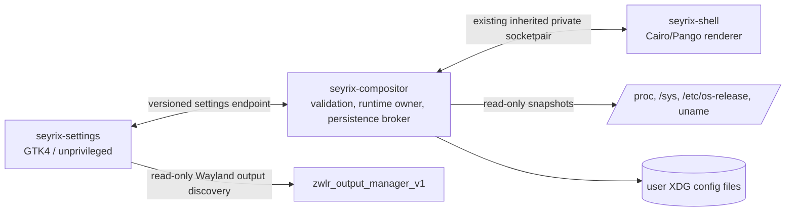

# Phase 2D.3 — Native System Settings Architecture

**Status: architecture baseline; Phase 2D.3B.5 recovery contract approved.** The authorized Settings recovery contract is supervised process relaunch with state restoration on stock GTK/GDK, replacing the earlier same-process expectation. This approval applies only to that recovery contract; all other architecture remains subject to review.

The design is based on the Phase 2D.2 checkout at `e05c66f0913c37a9009f5dafbd45e1326fef4cd1`, the Phase 2D.1 and Phase 2D.2 reports, and the current source in `desktop/compositor`, `desktop/shell`, `desktop/common`, `config`, `build`, and `tests`.

## 1. Existing architecture assessment

| Area | Implemented now | Boundary or gap relevant to Settings |
|---|---|---|
| Compositor | Native C17 server using wlroots 0.20.x, Wayland server APIs, xdg-shell, layer-shell, scene graph, input, outputs, workspaces, and window management. | It is the authority for live window, output, and input state. Keep new controls typed and bounded; do not add shell command execution. |
| Desktop shell | A separate unprivileged C17 Wayland client. It creates `wl_shm` surfaces, uses the layer-shell protocol for desktop/panel/overlays, draws with Cairo/Pango, loads images/icons with GdkPixbuf, and handles keyboard state with xkbcommon. | It is a purpose-built UI, not a reusable widget toolkit. It has no general settings form, accessibility tree, or responsive settings-page framework. |
| Shell/compositor IPC | `desktop/common/shell-ipc.h` defines version 1 fixed-size packets over a nonblocking Unix `SOCK_SEQPACKET` socketpair. The compositor creates the pair and passes one descriptor only to its direct shell child. Messages cover shell actions, workspace selection, and window snapshots/focus. | This is a private child channel, not a general application API. Keep it private; extend it only for the compositor and its owned shell to coordinate settings transactions. |
| Shell configuration | `$XDG_CONFIG_HOME/seyrix/shell.conf` (or `~/.config/seyrix/shell.conf`) stores dock/taskbar mode, top/bottom position, alignment, icon size, pins, wallpaper path, background color, shortcuts, switcher scope, and the legacy `auto_hide` field. The versioned parser validates known keys and bounded values. Reads reject symlinks; writes use a 0600 temporary file, `fsync`, and atomic rename. | Both shell and compositor load this file. The shell config library has a save API, but normal UI changes currently have no settings screen or live reload/commit flow. `auto_hide` is explicitly incomplete and the panel remains visible. |
| Window management | `window-management.c` owns Floating, Automatic Tiling, and Hybrid behavior. `wm-config.c` persists default and per-workspace modes, gaps, split ratio/orientation, and exact app-id classification rules in `$XDG_CONFIG_HOME/seyrix/window-management.conf`. | The compositor is already the only runtime owner for these values. Existing keyboard shortcuts can persist them, so Settings must call the compositor rather than edit this file. Workspace tree topology is rebuilt from live windows after restart; preferences persist. |
| Workspaces | Four fixed workspaces have independent mode, layout preferences, focus history, and window ordering. The shell presents workspace indicators and controls. | The number of workspaces is not a user setting today. Do not present dynamic workspace count as supported. |
| Outputs | `output.c` creates the `zwlr_output_manager_v1` global, reports connected outputs and state, rejects incomplete configurations and disabling every output, and runs `wlr_backend_test` before committing an apply request. Headless Phase 2D.1 tests covered two-output assignment, scale, disable/restore, and panel reassignment. | Apply is immediate. There is no compositor-owned user-confirmation timer, rollback transaction, or persisted display profile. QEMU acceptance uses one visible output; physical multi-monitor behavior is unverified. |
| Launcher and app integration | `app-catalog.c` uses GIO desktop-entry discovery and launch semantics. The compositor's session launches the shell as an ordinary user process. The current startup path checks the local `seyrix` account, logind session, runtime-directory ownership, and a single-session lock. | Register Settings as a normal desktop entry and executable; it needs no root helper, shell-specific layer surface, or special process privilege. |
| Tests and acceptance | Meson unit suites cover shell state/config/catalog/UI, window management, geometry, IPC decoding, and session locking. Headless and QEMU harnesses cover compositor regressions, shell recovery, workspaces, shutdown, and Weston fallback. Phase 2D.2's final image had ten graphical cold boots, eight interaction/restart cycles, and two complete end-to-end passes. | Reuse these baselines and add Settings-specific cases. A unit test for packet decoding alone is not proof of runtime authorization or transaction recovery. |

Phase 2D.1 reports a **PASS** for its tested window-management behavior. Phase 2D.2 final integration reports a **PASS** for the final graphical integration and acceptance campaign. These reports do not claim physical hardware compatibility or clear earlier dependency findings.

Known sanitizer findings stay separate in all Phase 2D.3 records:

- The Phase 2D.2 shell UI LSan report contains **141,472 bytes in 4,817 allocations**, with traces through Fontconfig/Pango rendering. It was recorded unsuppressed; no speculative cleanup was added.
- The separate Phase 2C.2 wlroots 0.20.2/Mesa EGL teardown finding remains unresolved when `EGL_KHR_display_reference` is unavailable and wlroots skips `eglTerminate`. It is a dependency-level finding and is not evidence of a new Settings defect.

## 2. Proposed application architecture

Build `seyrix-settings` as an ordinary unprivileged C17 Wayland application. It is a focused settings client, not a system-administration front end. It reads system facts, requests changes from their runtime owner, and keeps only its own small UI preferences.

Use four logical pieces:

1. **GTK4 application** — owns the main window, category navigation, local searchable setting descriptors, labels, validation messages, and confirmation dialogs. GTK handles standard Wayland window roles, focus, keyboard traversal, pointer input, accessibility semantics, scaling, and widget sizing.
2. **Settings model/client** — maps each control to a supported setting identifier and value type, maintains the latest compositor snapshot/revision, sends bounded requests, and reports accepted, rejected, stale, unavailable, or pending states to the page.
3. **Compositor session control endpoint** — a small typed user-session endpoint implemented in the compositor event loop. It owns runtime mutation and durable commits for compositor settings, coordinates shell-owned visual settings with the compositor-launched shell, and owns display rollback timers. It is not a root service.
4. **Existing shell** — remains the owner of drawing and panel behavior. The compositor uses its existing inherited child channel to prepare, commit, or abort a candidate shell configuration. That channel remains inaccessible to unrelated clients.

The Settings window is an xdg-toplevel GTK window. It must not use layer-shell, because it is an ordinary application window and should participate in normal focus, stacking, tiling, and workspace behavior. The app launches from the existing application catalog through `/usr/share/applications/seyrix-settings.desktop`.

There is no separate privileged daemon. The compositor already serializes live WM and output operations, and already supervises the shell child. Keeping transaction handling there avoids a second authority process and gives display rollback a lifetime independent of the Settings window. No root-owned process, D-Bus privilege bridge, sudo rule, or arbitrary command interface is part of this phase.

## 3. UI framework and rendering decision

| Approach | Fit with this repository | Decision |
|---|---|---|
| Extend the custom `wl_shm` + Cairo/Pango shell renderer | Reuses current libraries and visual constants, but would require building and maintaining widgets, text entry, list virtualization/scrolling, focus rings, accessibility, dialogs, responsive navigation, and keyboard semantics specifically for Settings. The shell's render loop and surfaces are optimized for a panel and overlays. | Do not use it for this application. Keep it for the shell it already implements. |
| GTK4 in C | Adds GTK4/GDK as a new native package, while using the existing GLib/GIO, Pango, Cairo, Wayland, and xkbcommon ecosystem. It provides accessible controls, keyboard traversal, text entry, file dialogs, focus behavior, and responsive layout without adding a separate language runtime or browser engine. | **Recommend GTK4**, with a focused widget set and no libadwaita dependency in the initial implementation. Add GTK4 explicitly to the graphics runtime/build package set and validate the target package version in the Arch build environment. |
| Electron, web UI, or another heavyweight runtime | Duplicates the native Wayland stack and adds a large runtime/build surface for a small local control app. | Out of scope. |

Use GTK4 widgets rather than a custom control renderer: a sidebar or compact category selector, `GtkStack` pages, a top search entry, grouped rows with a title and description, standard switches/drop-downs/spin controls, and inline error/status text. Reuse Seyrix colors, spacing, and icon language through a small app stylesheet/theme mapping; do not attempt to reuse the shell's hand-painted widget code.

On wide windows show persistent sidebar navigation. At the 640×480 QEMU desktop size, collapse it behind a category selector/header control and let page content scroll. Search filters a fixed descriptor list by label, description, and keywords; it does not require indexing arbitrary files or launching a search service. All controls must have labels, descriptions, visible keyboard focus, and pointer targets large enough for the QEMU tablet/mouse acceptance path.

## 4. Categories and feature boundary

| Category | Settings UI contract |
|---|---|
| **Appearance** | Select a local wallpaper; choose supported background presentation; choose the existing solid background color. The shell currently renders a wallpaper using a cover/crop transform and falls back to the configured color. Make `Fill` (current), `Fit`, `Center`, and `Stretch` available only after the shell renderer implements and tests them. Clearing the wallpaper selects the solid color. Theme support is an extension point, not a v1 theme engine. Do not expose blur, per-monitor wallpaper, animation, or compositor effects that do not exist. |
| **Desktop and Dock** | Dock/taskbar mode; top/bottom position; start/center/end alignment; icon size within the parser's 24–64 range; pinned installed desktop IDs from the existing GIO app catalog; the existing four workspace indicators. Show auto-hide as disabled with “Not implemented”; never persist a request that suggests it is active. |
| **Window Management** | Floating, Automatic Tiling, or Hybrid mode per workspace; inner/outer gaps in the existing 0–128 range; split ratio/orientation in existing bounds; exact app-id tiled/floating rules; the existing switcher active-workspace scope and supported launcher/switcher shortcuts. Clearly identify per-workspace values. Do not add focus-follows-mouse, arbitrary rule expressions, or dynamic workspace count without compositor support. |
| **Displays** | Read connected outputs and advertised modes, refresh rates, scale, transform, and arrangement. A requested mode is offered only if advertised by that output and accepted by backend test. Show an explicit “Keep these settings” confirmation after a temporary apply; rejection/timeout rolls back. Do not claim physical multi-monitor validation from a single-output QEMU display. |
| **Input** | Read-only keyboard and pointer capability summary from compositor-owned device state and current keyboard keymap/layout when available. Offer only shortcuts already supported by the compositor and the existing bounded shell shortcut set. Device-specific acceleration, repeat rate, remapping, or arbitrary keybinding editing remains unavailable until a compositor backend exists for it. |
| **About Seyrix** | Read `/etc/os-release`, `uname`, `/proc/cpuinfo`, `/proc/meminfo`, and readable DRM/sysfs identifiers. Show unavailable fields honestly. Add a small read-only `/usr/share/seyrix/build-info` record to the future image build for image/revision metadata; the app must still work if it is absent. No root permission is needed. |

The minimum release must contain all six categories, current supported settings, read-only output/input/system information, basic search, validation/error feedback, keyboard and pointer operation, and a layout that works at 640×480. Controls for unimplemented behavior are visibly disabled or informational and are excluded from mutation payloads. Future themes, custom keybinding maps, left/right docks, dynamic workspace counts, and per-output wallpapers are optional follow-up work.

## 5. Component and process boundaries

- **`seyrix-settings`** runs as the logged-in user and fails visibly if no active Seyrix compositor endpoint is available. It cannot write `shell.conf`, `window-management.conf`, or display configuration directly. It sends typed updates and renders compositor acknowledgments.
- **Compositor control endpoint** is created only while the compositor owns the Wayland session. It validates session ownership and typed operations, reads current config revisions, prepares candidate state, persists it, applies it, sends shell updates over the inherited private channel, and returns a request-correlated acknowledgment.
- **Shell child** owns Cairo/Pango/GdkPixbuf rendering and visual application behavior. It prepares wallpaper resources and candidate shell state before commit, then acknowledges the revision. It does not open a general-purpose control socket for Settings.
- **Wayland output discovery** uses the existing `zwlr_output_manager_v1` global for names, heads, modes, and current state. The Settings client may use it to display live capabilities, but it must use the compositor's transaction endpoint for guarded changes.
- **About data** is read directly from ordinary user-readable kernel and OS files. Missing or restricted facts become “Unavailable”; Settings must not ask a service to elevate or read protected device data.

## 6. Configuration ownership and persistence

“Behavior owner” identifies the component that defines and applies a setting. The compositor endpoint is the single session writer for shared runtime settings so that the Settings app, shell, and compositor cannot race as independent writers.

| Data | Behavior owner | Canonical user state | Single writer and application path |
|---|---|---|---|
| Wallpaper, background color/presentation, dock/taskbar mode, position, alignment, size, pins | Shell | Existing `$XDG_CONFIG_HOME/seyrix/shell.conf` | Compositor session transaction handler writes the validated shell snapshot. It asks the shell child to prepare it, then commits the same revision to both in-memory consumers. The shell remains the renderer and semantic owner. |
| Window modes, per-workspace layout preferences, app-id classification | Compositor WM | Existing `$XDG_CONFIG_HOME/seyrix/window-management.conf` | Compositor only. Keyboard changes and Settings changes use the same config transaction path. |
| Output mode, scale, transform, arrangement | Compositor output backend | Proposed `$XDG_CONFIG_HOME/seyrix/displays.conf` | Compositor only. Write only after explicit confirmation of a successful temporary output transaction. |
| Input device state and key dispatch | Compositor/input backend | Existing supported shortcut values remain schema-compatible in `shell.conf` initially; new device settings are not invented | Compositor only. Device-specific preferences are outside v1 unless an actual input API is implemented and tested. |
| Last page, window geometry, search text if persistence is useful | Settings application | Optional `$XDG_CONFIG_HOME/seyrix/settings.conf` | Settings app only; these values never control compositor behavior. This file is optional for the initial release. |
| OS, kernel, CPU, memory, graphics, build facts | OS/kernel/image build | `/etc/os-release`, `/proc`, `/sys`, `uname`, optional `/usr/share/seyrix/build-info` | Read-only. No config write and no privileged service. |

Use `$XDG_CONFIG_HOME` when it is absolute and valid; otherwise use `$HOME/.config`. Do not accept relative configuration roots or path components containing `.`/`..` traversal. Normalize directory creation to owner-only 0700. Open directory components with `O_DIRECTORY|O_NOFOLLOW`; open existing config with `O_NOFOLLOW`, then verify regular file, current uid ownership, safe mode, and a strict size limit. Write a unique same-directory temporary file with `O_CREAT|O_EXCL|O_NOFOLLOW`, mode 0600, full-write loop, schema validation, `fsync(file)`, `renameat`, then `fsync(directory)`. Reject unknown schema versions, unknown keys, duplicate keys, out-of-range numbers, invalid UTF-8, control characters, invalid desktop IDs, and unsupported enum values. Do not replace a malformed file with defaults until an explicit successful user save.

The existing shell and WM parsers already have useful validation and atomic-write behavior; Phase 2D.3 should consolidate and strengthen the user/owner/mode checks instead of bypassing them. A Settings request changes one owning config domain per transaction. Group related controls in that domain into a complete validated candidate, so a single file is never partially updated. Multi-file mutations are not part of v1.

For shell settings, use a prepare/commit/abort sequence over the private compositor-shell channel. The shell loads/decodes the proposed snapshot and allocates resources (including the candidate wallpaper) during prepare, without exposing them. Once the compositor has a complete candidate and has staged its durable write, it commits the file and swaps both runtime snapshots. A failed prepare/write/commit returns an error and restores the previous live/file snapshot before reporting failure. If the shell exits during commit, the compositor reports an indeterminate result, restarts the shell from the last committed file, and tells the Settings client to re-read the authoritative snapshot. For WM settings, validate all enum/range values and precompute affected layouts before replacing the active state. Never report success until persistence and live application have both succeeded.

## 7. IPC and security model

### Endpoint

Add a separate `AF_UNIX` `SOCK_SEQPACKET` endpoint at `$XDG_RUNTIME_DIR/seyrix/settings-v1.sock` (inside an owner-only `seyrix` runtime subdirectory). The compositor creates it after validating `XDG_RUNTIME_DIR`, sets the socket to uid-owned mode 0600, and removes only the socket inode it created during shutdown. If a path is already present at startup, use `lstat` without following links and probe it: refuse an active, non-socket, or wrong-owner path; remove a stale socket only when it is inside the verified private directory, owned by the session uid, and no listener accepts connections. Use `SOCK_CLOEXEC|SOCK_NONBLOCK`, bounded accepted clients, and a bounded per-request work queue so a client cannot stall the compositor event loop.

Authenticate every connection with `SO_PEERCRED`; require the peer uid to equal the active session uid and reject requests if the compositor/session identity is no longer valid. The endpoint is a same-user session API, not a per-executable identity system: another process running as the same user can connect. That is acceptable because it can only change that user's desktop preferences. Do not claim that the endpoint proves the connecting process is the GTK application. It grants no root, system-wide, package, device-node, arbitrary command, or arbitrary file-write capability.

This socket is distinct from `desktop/common/shell-ipc.h`. Never export, duplicate, or make the inherited shell descriptor discoverable through an environment variable, filesystem socket, or general application API. The new endpoint contains only the operations required by Settings and uses a different protocol/version namespace.

### Wire behavior

Use an explicit wire header with magic, major/minor protocol version, opcode, request ID, payload length, and base config revision. Encode integers in a defined byte order and define payload fields independently of C struct padding. Set a small documented maximum packet size; reject truncated/oversized records, unknown opcodes/flags, duplicate fields, extra trailing bytes, malformed text, stale revisions, invalid IDs, and values outside schema bounds. Never interpret payload text as shell syntax or a path to execute.

Minimum operations are `HELLO`, `GET_SNAPSHOT`, `SUBSCRIBE`, `SET_SETTINGS`, `DISPLAY_TEST`, `DISPLAY_APPLY_TEMPORARY`, `DISPLAY_CONFIRM`, and `DISPLAY_CANCEL`. A response repeats request ID and reports protocol/schema revision, status (`accepted`, `rejected`, `conflict`, `unavailable`, `pending`, or `indeterminate`), and a bounded error code/message. A successful mutation includes the new revision. Output capability enumeration remains on Wayland; requests refer to an observed connector/output generation and advertised mode tuple, which the compositor resolves and tests again.

The first request returns the full supported snapshot. Later notifications carry revision changes. If a notification is missed or a client reconnects, it requests a new snapshot. Use monotonically increasing session revisions and request IDs; duplicate transaction IDs are idempotent. Reject stale base revisions with `conflict` plus a fresh snapshot instead of silently overwriting another settings change. On disconnect, discard uncommitted work; a display rollback timer remains owned by the compositor, not the client. The app reconnects with bounded backoff, displays an offline status, and does not queue non-idempotent changes for later replay.

## 8. Display safety and rollback

1. **Discover.** Read connected heads, connector names, current state, advertised modes/refresh rates, scale limits, and transform/position through `zwlr_output_manager_v1`. Capture an output-generation revision. Do not manufacture modes.
2. **Validate.** The user chooses a mode advertised for that connector. The compositor checks the generation is current, rejects duplicate or unknown heads and disabling all heads, checks scale/position bounds, builds a complete configuration, and calls `wlr_backend_test`. A failed test changes no live state and returns a user-readable backend error.
3. **Apply temporarily.** Save a server-side snapshot of enabled outputs, modes, scales, transforms, and positions. Apply the tested state and start a compositor-owned 15-second confirmation timer. Do not persist the new profile yet. The UI shows a visible countdown and “Keep Changes” / “Revert” actions. The timer is not owned by a GTK dialog.
4. **Confirm or revert.** `DISPLAY_CONFIRM(transaction_id)` persists the candidate atomically and stops the timer. Explicit cancel, timeout, app disconnect, compositor-side transaction failure, or any unconfirmed change that makes the pending output set unusable invokes rollback. The user is never required to confirm through the same newly configured output only; if the confirmation surface cannot be presented, timeout restores the previous state.
5. **Recover.** Rebuild rollback state from currently connected outputs, because a saved `wlr_output*` may have been destroyed. Restore surviving outputs to prior valid modes and arrangement. If a prior output disappeared or the backend rejects restoration, keep at least one connected output enabled and use that output's current or backend-preferred tested mode at a safe origin/scale. Report partial recovery on the surviving session and retain a keyboard-accessible recovery path. Do not persist a failed candidate.

The compositor must test rollback itself and use the same bounded backend validation path as initial apply. Tests must include invalid modes, failed backend test, timeout, app crash, settings socket disconnect, output unplug during the timer, restoration rejection, and restart while a transaction is pending. A pending configuration is never loaded at next start; only confirmed profiles may be retried, and startup falls back to backend-selected modes if a saved profile is no longer valid. Existing standard output-management applies remain supported for other Wayland clients; this Settings UI uses the guarded transaction operation and does not claim to add a confirmation step to unrelated clients.

## 9. Implementation milestones

The display transaction is split into its own milestone because a bad output change can make every graphical recovery interaction invisible.

| Milestone | Scope | Exit condition |
|---|---|---|
| **2D.3A — Architecture and interface specification** | This document and checklist; no production code or dependency change. | Reviewed and approved; unresolved API decisions recorded. |
| **2D.3B — Native application foundation** | GTK4 C17 executable, desktop entry, navigation/search/page framework, About page, read-only endpoint snapshot, versioned settings endpoint, unprivileged launch, reconnect/error presentation. | Builds in target Arch environment; launches from app catalog; keyboard/pointer navigation at 640×480; malformed and unauthorized requests rejected. |
| **2D.3C — Appearance and desktop configuration** | Wallpaper chooser and renderer modes, color, dock/taskbar settings, pins, workspace indicators, explicit auto-hide unavailable state, shell prepare/commit/abort and persistence. | Live and restart behavior agree; failed wallpaper/config update leaves prior shell and compositor state intact. |
| **2D.3D — Window management and input** | Per-workspace WM controls, supported app-id rules, supported shortcut/switcher preferences, read-only input summary, config revisions and state notifications. | Existing window-management and input regression suites pass; no unsupported device controls appear active. |
| **2D.3E — Displays** | Output discovery, backend capability validation, temporary apply, compositor timer, confirmation, rollback, hot-unplug recovery, confirmed profile persistence. | Every safety case in §8 passes in headless and QEMU; no unconfirmed profile survives restart. |
| **2D.3F — Integration and acceptance** | Complete QEMU image integration, session/reconnect tests, accessibility and responsive review, sanitizer records, cold-boot campaign, Weston fallback, final report. | All mandatory criteria in §10 pass; existing Fontconfig/Pango and wlroots/Mesa findings remain separately recorded and unsuppressed. |

## 10. Testing and acceptance criteria

- **Build:** C17 warning-clean Meson builds for the Settings app, shell, and compositor in the target Arch environment; validate the selected GTK4 and wlroots/protocol package versions. Ensure Settings is in the image, the GIO desktop entry is discoverable, and the no-root session path is used.
- **Unit and schema:** test valid/default configs; unknown or duplicate keys; invalid versions/UTF-8; integer/enum boundaries; path traversal, control characters, symlinks, wrong file type/owner/mode; missing files; desktop-ID duplicates; unsupported modes; and image load failure. Test every Settings model descriptor and its declared owner/capability.
- **IPC:** test bad magic/version/length, truncation, excess bytes, unknown opcode/flags, invalid UTF-8, overlong fields, stale revision, duplicate ID, replay, bounded-client exhaustion, unauthorized uid, disconnect mid-transaction, reconnect snapshot, and lost acknowledgment. Decoder tests must also be exercised through the compositor dispatch path for representative operations.
- **Persistence:** inject failure before write, during write, before/after file `fsync`, at rename, at directory `fsync`, and during owner commit. Verify old or new complete snapshots only, mode 0600, directory mode/ownership, and no mixed shell/compositor revision. Run concurrent request attempts to verify serialization and conflict replies.
- **Restart/reconnect:** restart or crash the Settings app, restart/crash the shell child, terminate the compositor, and restart the session. Verify committed values reload, uncommitted values do not, the app refreshes a full snapshot, and there are no duplicate processes/sockets or orphaned pending transactions.
- **Settings compositor-loss recovery (Phase 2D.3B.5 contract):** stock GTK/GDK may terminate the Settings process on Wayland compositor loss. The session supervisor waits for compositor and Wayland-display readiness, then relaunches Settings only after unexpected termination. Restore the prior category, window state, and relevant UI preferences; enforce a single active instance; establish fresh authenticated IPC, snapshot, and subscriptions; use bounded retries/backoff and restart-loop protection. An intentional user close must suppress relaunch. Verify these behaviors through the production lifecycle manager, preserving old/new process identity evidence.
- **Window/input regressions:** run the existing compositor geometry and WM suites plus shell state/config/UI/IPC suites. In the running session recheck all three modes, tiled geometry/gaps, app rules, four workspaces, focus/switcher behavior, pointer move/resize, popups, shell restart, and focus/key dispatch after settings changes.
- **Graphical QEMU:** open Settings from the launcher and desktop entry; exercise search, every page, all labels, error feedback, keyboard traversal, pointer selection, resizing, 640×480 collapsed navigation, and interaction with a normal window. Verify pinning/wallpaper and shell restart where applicable. Run the existing final-ISO cold-boot campaign at ten independent boots to graphical readiness and at least two full end-to-end interaction passes.
- **Display:** use the existing headless multi-output path and graphical QEMU path for supported-mode change, unsupported-mode rejection, confirmation, cancel, timeout, app crash, socket disconnect, output removal during countdown, compositor restart, and fallback when rollback mode is gone. Retain logs and before/after output snapshots. Do not claim physical multi-monitor acceptance without physical hardware results.
- **Sanitizers:** run ASan/UBSan and LSan on all new native modules and applicable integrations. Preserve complete diagnostics. Do not add suppression files or call cleanup APIs solely to hide the existing Fontconfig/Pango or wlroots/Mesa findings; report them independently from new Seyrix-owned allocations.
- **Session recovery:** verify Weston fallback, compositor SIGTERM/SIGKILL cleanup, return to tty1, and clean guest shutdown through the Phase 2D.2 harness. Keep process-group limitations visible; do not claim strict containment for applications that call `setsid()`.

Acceptance requires the app to run as an ordinary user, show truthful state, apply only validated features, persist only successful changes, recover on reconnect, and preserve existing compositor/shell behavior. Passing unit tests alone is insufficient; the final image must pass graphical QEMU and display rollback acceptance.

## 11. Risks and unresolved decisions

- GTK4 is a new runtime/build dependency. Confirm package availability, size, theme behavior, and exact build flags in the target Arch environment before Phase 2D.3B is finalized. Do not fall back to custom controls solely to avoid recording that dependency.
- `zwlr_output_manager_v1` is an unstable wlroots protocol. Pin the expected protocol package/API and retain compile/runtime compatibility checks against the repository's wlroots 0.20.x target.
- Same-uid socket authentication protects the session from other user accounts, not from a malicious process running as the same user. The API's narrow user-preference capabilities are the security boundary; there are no privileged operations.
- Shell and compositor currently load the same shell config but have no live configuration transaction. The prepare/commit/abort extension and crash recovery must be designed and tested before exposing shell mutations.
- The current shell supports only a fill/cover wallpaper transform. New presentation modes need shell rendering implementation, image bounds, and QEMU evidence; they are not compositor capabilities.
- Display rollback cannot guarantee recovery from hardware/driver failure that also rejects the previous and preferred modes. The specified surviving-output fallback and keyboard recovery path reduce that risk; failures must be visible and logged.
- `/proc`, `/sys`, and DRM information varies across kernels and virtual hardware. About fields are best-effort and must tolerate missing or permission-restricted data.
- The GTK4 application may produce new library-attributed LSan allocations. Keep those traces separate from the existing shell UI Fontconfig/Pango finding; do not suppress either.
- The Phase 2D.2 acceptance image is a QEMU development image, not a physical hardware or production-readiness claim.

## 12. Exact files expected to be added or modified

The following is the planned implementation surface, not a claim that these files exist now. Keep each milestone's changes within its listed files unless review identifies a necessary dependency.

### Added now by Phase 2D.3A

| File | Purpose |
|---|---|
| `docs/phase2d3-architecture.md` | This architecture and interface specification. |
| `docs/phase2d3-checklist.md` | Concise implementation and acceptance checklist. |

### Expected during 2D.3B–2D.3F

| File(s) | Planned change |
|---|---|
| `desktop/settings/meson.build` | New C17 GTK4 application build and page/model tests. |
| `desktop/settings/src/main.c`, `settings-window.[ch]`, `settings-client.[ch]`, `settings-model.[ch]`, `settings-config.[ch]` | Application lifecycle, responsive navigation, endpoint transport, setting descriptors/search, and UI-only preferences. |
| `desktop/settings/src/settings-page-appearance.c`, `settings-page-desktop.c`, `settings-page-window.c`, `settings-page-display.c`, `settings-page-input.c`, `settings-page-about.c` | Native page implementations for the six categories. |
| `desktop/settings/data/seyrix-settings.desktop` | Normal application-catalog entry; install as `/usr/share/applications/seyrix-settings.desktop`. |
| `desktop/common/settings-ipc.h` | Versioned bounded wire format and shared decoder definitions for the Settings/compositor endpoint. |
| `desktop/compositor/src/settings-control.[ch]` | Session socket lifecycle, peer credentials, validation, revisions, dispatch, acknowledgments, and transaction coordination. |
| `desktop/compositor/src/main.c`, `seyrix.h`, `meson.build` | Initialize, register, and tear down the new control endpoint in the compositor event loop. |
| `desktop/compositor/src/output.c`, `desktop/compositor/src/seyrix.h` | Output capability snapshots, transaction testing, temporary apply, timer, confirmation, and rollback state. |
| `desktop/compositor/src/wm-config.c`, `window-management.c` | Candidate-state validation and one serialized writer for WM preferences. |
| `desktop/common/shell-ipc.h`, `desktop/compositor/src/shell.c`, `desktop/shell/src/main.c` | Private shell-child prepare/commit/abort messages and acknowledgments; do not expose this channel to Settings. |
| `desktop/shell/src/shell-config.c`, `shell-config.h`, `shell-ui.c`, `shell-ui.h` | Versioned shell config transaction support, live renderer update, bounded wallpaper decode, and tested presentation modes. |
| `config/graphics-overlay/packages.x86_64` | Add the GTK4 runtime dependency. |
| `build/build-phase2d3-iso.sh` | Phase-specific build/package integration and build-info installation without rewriting Phase 2D.2 history. |
| `tests/settings-config-test.c`, `settings-ipc-test.c`, `settings-model-test.c`, `settings-display-transaction-test.c` | Schema, permission, transport, model, and display rollback coverage. |
| `tests/shell-config-test.c`, `tests/shell-ipc-test.c`, `tests/qemu-graphics.exp`, `tests/qemu-graphics.sh`, `tests/qemu-cold-boot-campaign.sh` | Extend existing shell and final-image acceptance paths with live Settings and rollback cases. |
| `docs/roadmap.md`, `README.md`, `docs/phase2d3-implementation-report.md` | Update phase status and record final evidence after implementation acceptance. |

No source, package list, dependency declaration, or build script is changed by this 2D.3A deliverable.
