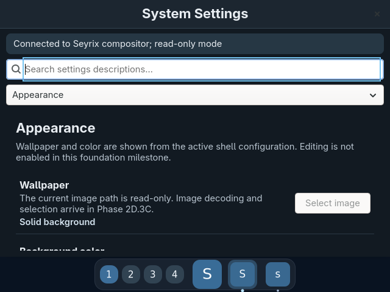
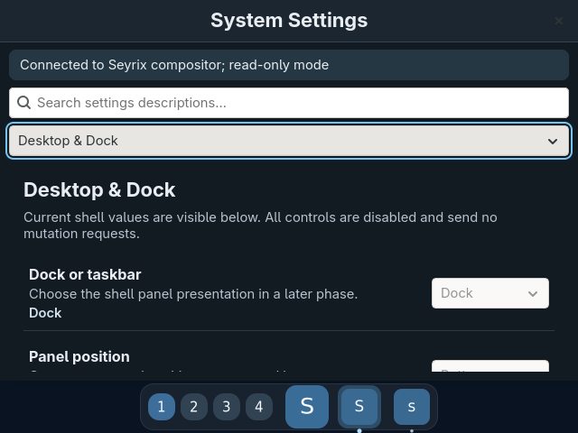

# Focused Settings rendering verification

**Focused result: PASS after corrected offline replay. Phase 2D.3B remains INCOMPLETE.**

One prior QEMU boot captured the real Settings application changing from Appearance to Desktop & Dock. The original on-guest run remained `INCOMPLETE` because its harness rejected valid GTK/render event ordering and did not emit a verified-input pass marker. The corrected production parser and screenshot comparator replayed that same preserved capture successfully; no second boot was used.

The corrected replay confirmed the verified input, GTK page selection and map transition, a matching client Wayland attach/damage/commit sequence, the corresponding compositor surface commit and output presentation, and a changed QMP screenshot. The page-content region changed **21,108 of 140,740 pixels**; the full frame changed **48,667 of 307,200 pixels**. The screenshot comparator passed.

Image SHA-256:

- `appearance-before.png`: e66eae278991e36c1bb22c6248232d327265e7600a2762dd5f68467274061bb8
- `desktop-dock-after.png`: ec052b158210caca44091f3200bd2c0787a1940543845f72900c5f6997fe0f3e

This result is a corrected offline replay of preserved live capture data. It does not change the original on-guest `INCOMPLETE` result or complete the phase. Broader acceptance still needs normal launcher integration, all six categories, search and responsive navigation, 640×480 usability, endpoint subscription/reconnect/connection-loss checks, wider compositor and shell regressions, and the remaining cold-boot/native acceptance campaign.

No ISO was rebuilt or promoted. No Phase 2D.3C work was performed.