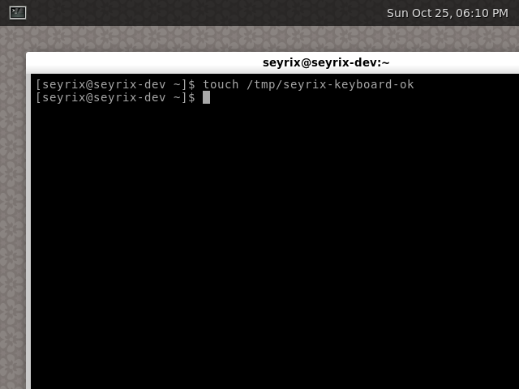

# Phase 2A Wayland and QEMU testing

## Commands

Run from PowerShell with the repository at
`C:\Users\quake\Desktop\Coding\Seyrix-Linux` and the Arch WSL distribution
available:

```powershell
wsl -d archlinux -u root -- bash /mnt/c/Users/quake/Desktop/Coding/Seyrix-Linux/build/build-phase2a-iso.sh
wsl -d archlinux -u root -- bash /mnt/c/Users/quake/Desktop/Coding/Seyrix-Linux/tests/qemu-graphics.sh /root/.cache/seyrix-linux/phase2a-20261025T174234Z/out/seyrix-phase2a-2026.10.25-x86_64.iso
wsl -d archlinux -u root -- bash /mnt/c/Users/quake/Desktop/Coding/Seyrix-Linux/tests/qemu-uefi.sh /root/.cache/seyrix-linux/phase2a-20261025T174234Z/out/seyrix-phase2a-2026.10.25-x86_64.iso
```

From an Arch shell at the repository root, the corresponding commands are:

```bash
bash build/build-phase2a-iso.sh
bash tests/qemu-graphics.sh /root/.cache/seyrix-linux/phase2a-20261025T174234Z/out/seyrix-phase2a-2026.10.25-x86_64.iso
bash tests/qemu-uefi.sh /root/.cache/seyrix-linux/phase2a-20261025T174234Z/out/seyrix-phase2a-2026.10.25-x86_64.iso
```

Each build and test run uses a new timestamped directory. The scripts refuse
to overwrite an existing output directory.

## QEMU profile

The graphical run used these host packages:

- `qemu-system-x86` 11.1.2-1 and `qemu-ui-gtk` 11.1.2-1.
- `qemu-hw-display-virtio-gpu` and `qemu-hw-display-virtio-vga`, both
  11.1.2-1.
- `edk2-ovmf` 202608-1 and Expect 5.45.4-5.
- q35 machine with TCG, `qemu64`, 2 vCPUs, and 4 GiB guest RAM.
- OVMF UEFI code and a private writable copy of the OVMF variables template.
- The Phase 2A ISO as a CD-ROM; no virtual hard disk or host storage passthrough.
- `virtio-vga`, QEMU xHCI, one USB keyboard, and one USB tablet.
- GTK through WSLg with `gl=off`; user-mode networking; serial stdio and QMP.

The host was Windows 10 with Arch Linux on WSL2, kernel
`6.18.54.1-microsoft-standard-WSL2`. It had no `/dev/kvm`; QEMU therefore
used TCG. The exact QEMU command and package versions are in
[run metadata](evidence/phase2a/graphics-verified-exit/run-metadata.txt) and
[qemu-command.txt](evidence/phase2a/graphics-verified-exit/qemu-command.txt).

## Automated graphical workflow

The test boots the ISO through OVMF, logs in through the existing serial root
console, and checks the kernel, systemd, logind, network services, package
count, Virtio PCI device, DRM card, and input device nodes. It then:

1. Confirms the unprivileged automatic tty1 development session is active.
2. Selects tty1 and types `start-wayland` through QMP keyboard events.
3. Requires the Wayland-ready marker, Weston, and `weston-terminal` to remain
   active after a stability interval.
4. Saves a QMP desktop image, types
   `touch /tmp/seyrix-keyboard-ok` into Weston Terminal, and verifies the
   guest marker. The screenshot shows the command and the returned prompt.
5. Moves the USB tablet pointer to two absolute positions, captures each
   pointer position, and checks the guest `evtest` log for ABS_X and ABS_Y.
6. Confirms Weston and its terminal are still active, types `exit`, checks
   that the launcher removed its ready marker and returned to the tty1 shell,
   then captures the tty1 screen.
7. Runs `systemctl poweroff` and requires QEMU to exit successfully.

### Desktop and keyboard

This QMP screenshot was captured during the final run. The command in the
Weston Terminal created the guest marker; the next prompt shows the terminal
accepted the input.



### Mouse input

The guest `evtest` log recorded ABS_X/ABS_Y at (2500, 2500) and
(29000, 21000). These QMP screenshots show the pointer at the two tested
positions on the compositor background.


The exit check also verified the tty1 getty and `seyrix` shell were active
after Weston stopped. Its result is recorded as `TTY1_SHELL_RETURN=passed` in
the test transcript.

## Results and measurements

Final graphics run: 2026-10-25 18:08 UTC. The full output is preserved in
[test transcript](evidence/phase2a/graphics-verified-exit/test-transcript.txt)
and [serial transcript](evidence/phase2a/graphics-verified-exit/serial-transcript.txt).

| Check | Result |
|---|---|
| Firmware, kernel, systemd, and logind | PASS; UEFI, kernel `7.2.11-arch1-1`, PID 1 systemd |
| Virtio display | PASS; PCI `1af4:1050`, `virtio_gpu`, DRM `/dev/dri/card1` |
| tty1 development login | PASS; UID 1000, local tty1, active logind session |
| Weston DRM and logind seat | PASS; DRM backend selected card1, libseat logind session control granted |
| libinput devices | PASS; Weston log configured the USB keyboard and USB tablet |
| Wayland session and terminal app | PASS; both processes remained active through the pre-exit check |
| Visible background and terminal | PASS; QMP screenshot above |
| Keyboard | PASS; guest marker created by command typed in Weston Terminal |
| Mouse | PASS; USB tablet ABS_X/ABS_Y events logged and pointer visible at both positions |
| Session exit and tty return | PASS; marker cleared, tty1 shell/getty active |
| Guest shutdown | PASS; QEMU exited successfully after systemd poweroff |
| Phase 1 terminal regression on this ISO | PASS; serial login in 58,418 ms and clean shutdown |

| Performance value | Measurement |
|---|---:|
| QEMU start to serial login | 62,795 ms |
| QEMU start to Wayland ready marker | 84,854 ms |
| Memory total | 3,994,664 KiB |
| Memory available at login | 3,617,288 KiB |
| Memory available with Wayland active | 3,557,344 KiB |
| Approximate memory used with Wayland active | 437,320 KiB |
| Running services with Wayland active | 15 |
| Installed package count | 233 |
| ISO bytes | 1,038,123,008 |

The boot durations include OVMF, bootloader, kernel, userspace, and the manual
Wayland launch. The used-memory value is total minus `MemAvailable`; it is an
approximation, not process RSS. The observed renderer was
`llvmpipe (LLVM 23.1.3, 128 bits)`, using GL ES 3.2. `LIBGL_ALWAYS_SOFTWARE=1`
was set in the launcher; QEMU used TCG with `gl=off` and VirGL disabled.
Hardware acceleration is not claimed, and these measurements are not compared
with native hardware.

## Automated results and manual observation

The test injected keyboard and mouse events with QMP, verified input with
guest-side file and evdev checks, captured screens with QEMU QMP, and checked
session and shutdown state from the guest. The QMP screenshots were converted
from PPM to PNG without pixel edits and visually inspected after the run. The
QEMU window was not manually operated.

The preserved test transcript, serial log, command, metadata, and screenshot
hash list are in
[evidence/phase2a/graphics-verified-exit](evidence/phase2a/graphics-verified-exit/).
The terminal regression artifacts are in
[evidence/phase2a/terminal-regression](evidence/phase2a/terminal-regression/).
Build warnings and the final ISO hash are in
[the build evidence](evidence/phase2a/build-transcript.txt) and
[package metadata](phase2a-package-metadata/).
